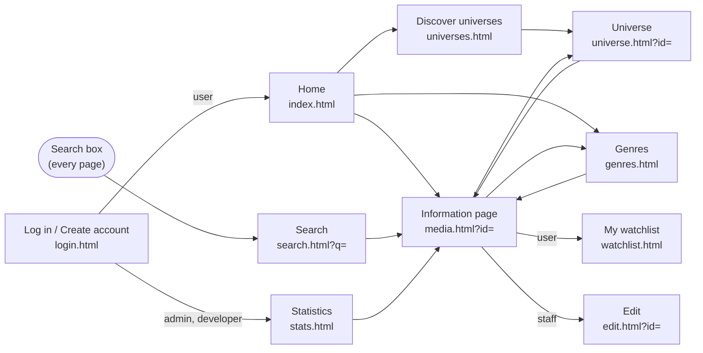

# User journeys

This file walks through the website the way people use it: what they click, what they see, and
what happens in the database behind each step. It covers the four kinds of visitor in order —
**guest → user → admin → developer** — because each one can do everything the one before can
(except that staff accounts have no watchlist).

For how each step is coded, see [`media-universe-backend/HOW_IT_WORKS.md`](media-universe-backend/HOW_IT_WORKS.md).
The numbers *Flow 1 … Flow 10* are the user flows from the project proposal.

---

## Map of the site

Every page has the same header: **Home · Genres · Universes**, a search box, and **Log in** (or the
account name, its role badge and **Log out**). Logged-in users also get **Watchlist**; admins and
developers get **Edit** and **Statistics**.

| Can… | Guest | User | Admin | Developer |
|---|:-:|:-:|:-:|:-:|
| Browse, search, genres, universes, information pages | ✓ | ✓ | ✓ | ✓ |
| Keep a watchlist | | ✓ | | |
| Add, edit and delete titles; change genre; add or delete universes | | | ✓ | ✓ |
| See statistics and the account list | | | ✓ | ✓ |
| Change roles, delete accounts | | | | ✓ |

---

## Part 1 — Guest (not logged in)

### 1.1 Land on the Home page

1. The visitor opens `http://localhost:4500`.
2. They see, from top to bottom:
   - **Highest rated** — one big banner for the best-rated title, with its rating, year, type,
     genre and universe. **View details** opens its information page.
   - **Explore universes** — up to 6 universe tiles, each showing the poster of its oldest title.
   - **Top 5 media** — the five highest-rated titles.
   - **Browse everything** — every title as a poster card, with filters: **All / Movies / Series**,
     a genre dropdown and a sort order (rating, newest, oldest, title). Changing a filter reloads
     the grid straight away and shows how many titles match.

> **Behind the scenes:** `GET /media?sort=rating&limit=1` (banner), `GET /universes` and one
> `GET /universes/:id` per tile, `GET /media/toprates`, and `GET /media?sort=…&type=…&genre=…`
> for the grid. All of them only read (`SELECT`) — nothing changes in the database.

### 1.2 Search for anything — *Flow 1*

1. The visitor types into the search box in the header, for example `rowling`, and presses Enter.
2. The Search page opens with `search.html?q=rowling` in the address bar, so the back button and
   sharing the link both work.
3. They see **"N results for "rowling""** and the matching poster cards. They can narrow it down
   with **Movies / Series** and a genre, then press **Search** again.
4. The search looks in far more than titles: the synopsis, the director, the universe, the genre,
   the actors, the titles of the books a film is based on, and the books' authors.
   So `rowling` finds every Harry Potter film through its books' author, and `robert downey`
   finds the Iron Man films through the cast. Titles that match by name are listed first.
5. If nothing matches they see *"No titles match … Try a shorter word or a different spelling."*

> **Behind the scenes:** `GET /media/search?q=rowling` — one `SELECT` that joins `Media` with its
> director, universe, genre, `Media_Actor → Actor` and `Media_Book → Book → Author`.

### 1.3 Open a title — *Flow 2*

1. The visitor clicks any poster. The information page `media.html?id=2` opens.
2. They see the poster, the title, the rating, the main genre and sub-genres (each one links to
   that genre), the synopsis, and a fact list: release date, length (or number of episodes),
   age rating, status, category and country, director, universe, the platforms to watch it on,
   the cast and the number of visits.
3. Below that are the **cross-references** — the point of the whole project:
   - **Adaptation chain** — the previous film, its sequels, what it is a remake of, and its remakes.
   - **Based on** — the books it adapts, with author, publisher and year.
   - **More from *universe name*** — every other title in the same universe, and a link to the
     whole universe.
4. As a guest they also see **+ Add to watchlist** with *"Log in to keep a watchlist."*
   (see [2.3](#23-add-a-title-to-the-watchlist--flow-4)).

> **Behind the scenes:** opening the page first sends `POST /media/2/visit`, which adds 1 to
> today's count in the `Media.visits` column, then `GET /media/2` reads the title and runs ten
> `SELECT`s at the same time for the sub-genres, cast, platforms, books, sequel/remake links,
> same-universe titles and the visit counts. Every linked title and book comes with its own
> poster.

### 1.4 Browse by genre — *Flow 3*

1. The visitor clicks **Genres** in the header (or a genre chip on an information page).
2. They see a row of genre chips, each with the number of titles that use it. The genre with the
   most titles is selected first, unless the link already named one.
3. Clicking a chip shows **"Fantasy · 15 titles"** and the posters. A title counts if the genre is
   its **main** genre or one of its **sub-genres**; main-genre matches come first.

> **Behind the scenes:** `GET /genres` for the chips, then `GET /genres/:id/media`.

### 1.5 Discover universes — *Flow 9*

1. The visitor clicks **Universes**. They see the top 10 universes, largest first. Each card has
   a collage of posters, the number of titles, movies and series, the years it spans, its
   average rating and how many books it is based on.
2. Clicking a universe opens the **Universe** page: every title in **release order** on a
   timeline (year, type, director, genre, rating), and **The books behind it** underneath.

> **Behind the scenes:** `GET /universes` (one grouped `SELECT`), then `GET /universes/:id`,
> whose title list comes from the stored procedure: `CALL get_universe_media(3)`.

---

## Part 2 — Normal user

### 2.1 Create an account — *Flow 5*

1. The visitor clicks **Log in** → **Create account** tab.
2. They fill in **Username**, **Email** and **Password** (at least 8 characters) and press
   **Create account**.
3. They see *"Account created — logging you in…"*, are logged in automatically and land on Home.
   The header now shows their name with a **user** badge, and a **Watchlist** link.
4. Things that can go wrong, with the message shown under the form:
   - password shorter than 8 characters → *"Password must be at least 8 characters"*
   - email not in the form `name@site.com` → *"gmail is not a valid email address"*
   - username or email already taken → *"username or gmail is already used"*

> **Behind the scenes:** `POST /accounts/register`. The password is hashed with bcrypt — the
> database only ever stores a 60-character hash like `$2a$10$…`, never the password. One
> transaction inserts the account into `User` and `Normal_User`, so it is never half-created.

### 2.2 Log in and log out

1. **Log in** tab → **Username or email** and **Password** → **Log in**.
2. A normal user lands on Home. If they were sent to the login page from somewhere else (for
   example by pressing **+ Add to watchlist**), they go straight back to that page instead.
3. A wrong username and a wrong password give the same message, *"wrong username or password"*,
   so nobody can find out which usernames exist.
4. **Log out** in the header ends the session and returns to Home.
5. If the server restarts, everyone is logged out. The next page they open notices this and
   quietly shows them as logged out; an action that needs a login sends them to the login page.

> **Behind the scenes:** `POST /accounts/login` checks the password with `bcrypt.compare` and
> returns a random token. The browser keeps the token in `localStorage` and sends it with every
> request as `Authorization: Bearer <token>`. `POST /accounts/logout` forgets the token on the
> server.

### 2.3 Add a title to the watchlist — *Flow 4*

1. On an information page, a guest presses **+ Add to watchlist** → they are sent to log in →
   after logging in they come back to the same title.
2. A logged-in user presses **+ Add to watchlist**. A message says *"Added to your watchlist"*
   and the button changes to **✓ In your watchlist · remove**.
3. Pressing that button again removes it (*"Removed from your watchlist"*).
4. Admins and developers don't see the button: only normal users have a watchlist.

> **Behind the scenes:** `POST /watchlist { media_id }` inserts one row into `Watchlist`
> (account + title). Adding the same title twice is refused by the table's primary key and
> answered with *"already in your watchlist"*.

### 2.4 Use the watchlist page — *Flow 6*

1. The user clicks **Watchlist** in the header and sees **"N saved titles"** and the posters.
2. On the side, a **Filter** panel offers a genre (pick one) and platforms (pick any), each
   platform with how many saved titles it has. Choosing filters shows, for example,
   **"3 of 8 saved titles"** — the titles in that genre that are on *any* of the ticked platforms.
3. The **✕** button on a poster removes that title (*"Removed from your watchlist"*); the list and
   the platform counts update.
4. An empty watchlist says *"Your watchlist is empty. Open any title and press + Add to watchlist."*
5. A guest or a staff account opening this page sees *"Please log in…"* or *"This page is only for
   user accounts."*

> **Behind the scenes:** `GET /watchlist/filters` (total and per-platform counts),
> `GET /watchlist?genre=…&platforms=1,2` (the list), and `DELETE /watchlist/:mediaId`
> (Flow 6: deletes one `Watchlist` row of *this* account only).

---

## Part 3 — Admin

Demo login: `admin` / `admin123`. After logging in, an admin lands on **Statistics**. The header
shows an **admin** badge and the **Edit** and **Statistics** links.

### 3.1 Add a movie or series — *Flow 7*

1. **Edit** in the header opens **Add a movie or series**.
2. The admin fills in the form:
   - **Basics:** type (movie or series), title, duration in minutes *or* number of episodes,
     release date, rating (0–9.9), age rating, status, category, country, synopsis.
   - **Genres:** one main genre and any sub-genres (the main genre can't also be a sub-genre).
   - **People:** the director and the actors, typed by name. Names already in the database are
     suggested; a new name is added to the database automatically.
   - **Connections:** universe, *Sequel of*, *Remake of*, platforms and the books it is based on.
     A new universe can be created right there with **New universe**.
3. **Save** checks the form first (for example *"Duration is required for a movie"*), then saves
   and opens the new title's information page.
4. **The trigger at work:** if the admin picks a *Sequel of* (or *Remake of*) title but leaves
   **Universe** on *— none —*, the new title joins its parent's universe by itself. Adding
   *Iron Man 4* as a sequel of *Iron Man 3* puts it in the *Marvel Cinematic Universe*.

> **Behind the scenes:** `POST /media`. One transaction inserts into `Media`, then `Movies` or
> `Series`, then the link tables `Subgenre`, `Media_Actor`, `Media_Platform` and `Media_Book`,
> and creates any new `Director` / `Actor` rows. If anything fails, all of it is rolled back.
> The `media_inherit_universe` trigger fills in `universe_id` during the `INSERT INTO Media`.

### 3.2 Edit, change the genre, or delete a title — *Flow 8*

There are two places to do this:

- **On the information page** an **admin tools** bar appears: **Edit all fields**, a genre
  dropdown with **Change main genre**, and **Delete**.
- **On the Edit page**, the dropdown *Edit an existing title…* loads any title into the form.
  The type can't be changed (a movie can't become a series). **Save** stores the changes;
  **Delete this media** removes it.

1. **Change main genre** (Flow 8) → *"Genre updated"*, and the page reloads with the new genre.
2. **Save** on the Edit page → *"Changes saved"*.
3. **Delete** asks *"Delete "…"? It is also removed from every watchlist."* and then goes back
   to Home (or the Edit page).

> **Behind the scenes:** `PUT /media/:id/genres` (Flow 8), `PUT /media/:id` (edit) and
> `DELETE /media/:id`. Deleting runs in one transaction: sequels and remakes of the title are
> kept but lose the link, then its rows in every link table and in `Watchlist` are removed,
> and finally the `Media` row itself.

### 3.3 Add or delete a universe

1. On the Edit page, type a name under **New universe** and press Enter (or the add button).
   It is created and selected in the **Universe** dropdown.
2. Pick a universe in the dropdown and press **Delete**. The confirmation says how many titles
   it has; those titles are **kept** and become standalone.

> **Behind the scenes:** `POST /universes` and `DELETE /universes/:id` (one transaction:
> `UPDATE Media SET universe_id = NULL …`, then `DELETE FROM Universe …`).

### 3.4 Read the statistics — *Flow 10*

The Statistics page shows, from top to bottom:

1. **Number tiles:** titles, movies, series, books, universes, accounts, watchlist saves and
   total visits.
2. **Visits over time:** a line chart of information-page visits per day. Filters: **All /
   Movies / Series** and **Last 7 / 30 / 90 days**. Hovering (or the arrow keys) shows each
   day's number, a table lists every day, and **Most visited** shows the top 5 titles.
3. **Bar charts:** *Media per main genre*, *Media per universe*, *Most watchlisted* and
   *Top rated*. Hover a bar for details; click a title to open it.
4. **Group and sort:** pick **Group by** (main genre, universe, category, country, type, age
   rating, status, director or release year) and **Sort by** (media count, average rating,
   watchlist saves or name). The table shows the count, average and best rating and watchlist
   saves of each group.
5. **Accounts:** every account with its email, role and watchlist size. For an admin this table
   is **read only**: *"Only developers can change roles or delete accounts."*

> **Behind the scenes:** `GET /stats`, `GET /stats/visits?type=…&days=…`,
> `GET /stats/group?by=…&sort=…` and `GET /accounts`. Everything is calculated live from the
> tables — nothing is stored.

---

## Part 4 — Developer

Demo login: `developer` / `dev12345`. A developer can do everything an admin can, and also
manage accounts in the **Accounts** table on the Statistics page.

### 4.1 Change someone's role

1. Each other account has a role dropdown (**user / admin / developer**). Your own row only shows
   *(you)* — you can't change your own role.
2. Choosing **admin** or **developer** asks *"Make this account admin? Its watchlist will be
   removed."* (only normal users can have a watchlist).
3. *"Role changed to admin. They must log in again."* — that person is logged out at once, and
   gets the new role and menu the next time they log in.

> **Behind the scenes:** `PUT /accounts/:id/role`. One transaction removes the account from
> `Normal_User`, `Admin` and `Developer` (and deletes its `Watchlist` rows), then inserts it
> into the one table for the new role. The roles are disjoint subtypes of `User`, so an account
> is always in exactly one of them.

### 4.2 Delete an account

1. **Delete** on a row → *"Delete the account "…" and its watchlist?"* → *"Account deleted"*.
2. The account is logged out everywhere, and the tiles and table refresh.

> **Behind the scenes:** `DELETE /accounts/:id` — one transaction removes the watchlist, the role
> row and the `User` row.

### 4.3 What an admin sees if they try

The server checks the role on every request, not just the page. An admin who sends the same
request anyway (for example with curl) gets **403** *"only developer accounts can do this"*.

---

## When something goes wrong

| What happened | What the visitor sees |
|---|---|
| Opened a page that needs a login while logged out | *"Please log in to see this page."* with a link that brings them back afterwards |
| Opened a page for another role | *"This page is only for admin / developer accounts. You are logged in as …"* |
| Their login token expired (server restarted) | They are shown as logged out; the next action that needs a login opens the login page |
| Opened a title or universe that doesn't exist | *"media not found. Back to home"* / *"universe not found"* |
| A form value is wrong | A message under the form, e.g. *"rating must be a number from 0 to 9.9"* |
| An unexpected server or database error | *"Something went wrong, please try again later"* — the real error is only printed in the server terminal |

---

## Proposal flows → this document

| Flow | Name in the proposal | Section |
|---|---|---|
| 1 | Search | [1.2](#12-search-for-anything--flow-1) |
| 2 | Click a banner | [1.3](#13-open-a-title--flow-2) |
| 3 | Select a genre | [1.4](#14-browse-by-genre--flow-3) |
| 4 | Add to watchlist | [2.3](#23-add-a-title-to-the-watchlist--flow-4) |
| 5 | Create an account | [2.1](#21-create-an-account--flow-5) |
| 6 | Remove from watchlist | [2.4](#24-use-the-watchlist-page--flow-6) |
| 7 | Admin adds a movie or series | [3.1](#31-add-a-movie-or-series--flow-7) |
| 8 | Admin changes a genre | [3.2](#32-edit-change-the-genre-or-delete-a-title--flow-8) |
| 9 | Discover universes | [1.5](#15-discover-universes--flow-9) |
| 10 | Statistics | [3.4](#34-read-the-statistics--flow-10) |
