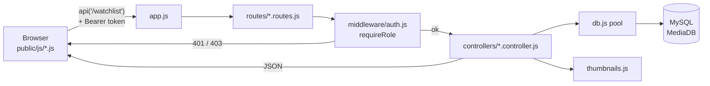

# How the backend works

This file explains the main functions of the backend: what each one receives, what it does step
by step, and what it sends back. For the list of endpoints see [README.md](README.md); for what
the visitor sees, see [USER_JOURNEY.md](../USER_JOURNEY.md).

**Contents**

1. [The life of one request](#1-the-life-of-one-request)
2. [Start-up: `app.js` and `db.js`](#2-start-up-appjs-and-dbjs)
3. [Logging in: accounts, tokens and roles](#3-logging-in-accounts-tokens-and-roles)
4. [The shared media query: `MEDIA_SELECT`](#4-the-shared-media-query-media_select)
5. [Thumbnails: linking pictures to titles](#5-thumbnails-linking-pictures-to-titles)
6. [Listing media: `list`, `toprates`](#6-listing-media-list-toprates)
7. [Search](#7-search)
8. [The information page: `getOne`, `recordVisit`](#8-the-information-page-getone-recordvisit)
9. [Adding, editing and deleting media](#9-adding-editing-and-deleting-media)
10. [Universes and the stored procedure](#10-universes-and-the-stored-procedure)
11. [The trigger](#11-the-trigger-media_inherit_universe)
12. [Genres](#12-genres)
13. [Watchlist](#13-watchlist)
14. [Statistics](#14-statistics)
15. [Managing accounts (developer)](#15-managing-accounts-developer)
16. [Errors](#16-errors)
17. [Why the SQL is safe from injection](#17-why-the-sql-is-safe-from-injection)

---

## 1. The life of one request



Example: a user opens the watchlist page.

1. `public/js/watchlist.js` calls `api('/watchlist')`. `api()` in `public/js/common.js` adds the
   header `Authorization: Bearer <token>` and calls `fetch`.
2. `app.js` sees the path starts with `/watchlist` and hands it to `routes/watchlist.routes.js`.
3. That router runs `requireRole('user')` first. No valid token → **401**; wrong role → **403**;
   otherwise it puts the account on `req.user` and continues.
4. `watchlist.controller.list` runs one `SELECT` through the pool from `db.js`.
5. Each row gets a `thumbnail` URL from `thumbnails.js`, and the list is sent back as JSON.
6. `api()` turns the JSON back into objects; on an error status it throws an `Error` carrying the
   server's message, which the page shows as a toast or a form message.

Every route follows this same pattern: **router → (role check) → controller → pool → JSON**.

---

## 2. Start-up: `app.js` and `db.js`

### `app.js`

Runs once when you type `npm start`. In order, it:

1. Loads `.env` into `process.env` (`require('dotenv').config()`).
2. `express.json()` — reads JSON request bodies into `req.body`.
3. `express.static('public')` — serves the HTML, CSS and JS pages.
4. Serves the picture folders: `DB_lab_project/DB_image` at `/images/media` and
   `DB_lab_project/book_image` at `/images/books` (paths come from `thumbnails.js`).
5. Mounts the seven routers: `/accounts`, `/media`, `/genres`, `/universes`, `/watchlist`,
   `/stats`, `/lookups`.
6. Any other path → `404 { "error": "endpoint not found" }` (JSON, not Express's HTML page).
7. `errorHandler` last, for anything a route didn't catch (see [Errors](#16-errors)).
8. Listens on `PORT` from `.env`, default 4500.

### `db.js`

Creates **one shared connection pool** that every controller imports:

```js
mysql.createPool({
  host, user, password, database,   // from .env — the app logs in as media_app, never root
  connectionLimit: 10,              // at most 10 open connections, reused between requests
  dateStrings: true,                // DATE comes back as '2001-11-16', not a JS Date
  decimalNumbers: true              // DECIMAL (rating, duration) comes back as a number
});
```

Controllers use the pool in two ways:

- `pool.execute(sql, values)` / `pool.query(sql, values)` — one statement, the pool picks a free
  connection and returns it afterwards. Both fill each `?` safely from the `values` array.
- `pool.getConnection()` — borrow **one** connection for a transaction, because
  `BEGIN … COMMIT` only works if every statement goes through the same connection. These
  functions always end with `conn.release()` in a `finally` block, so the connection goes back
  to the pool even after an error.

---

## 3. Logging in: accounts, tokens and roles

Files: `controllers/accounts.controller.js`, `middleware/auth.js`.

### Roles come from the subtype tables

`User` has three disjoint subtypes: `Normal_User`, `Admin`, `Developer`. An account's role is
whichever subtype table holds its `accountID`. `ACCOUNT_SELECT` works it out with two
`LEFT JOIN`s:

```sql
CASE WHEN d.accountID IS NOT NULL THEN 'developer'
     WHEN a.accountID IS NOT NULL THEN 'admin'
     ELSE 'user' END AS role
FROM User u
LEFT JOIN Developer d ON d.accountID = u.accountID
LEFT JOIN Admin a     ON a.accountID = u.accountID
```

### `register` — `POST /accounts/register { username, password, gmail }`

1. Checks the input: all three are text; username ≤ 60 and email ≤ 100 characters; password
   ≥ 8 characters; email looks like `x@y.z`. Any problem → **400** with the reason.
2. `bcrypt.hash(password, 10)` — makes a salted hash (cost 10). The result is always 60
   characters, which is exactly `User.password VARCHAR(60)`. Two people with the same password
   get different hashes, because each hash has its own random salt.
3. In **one transaction**: `INSERT INTO User …`, then `INSERT INTO Normal_User (accountID)`
   with the new id. Both rows exist, or neither does.
4. A duplicate username or email breaks a `UNIQUE` key (`ER_DUP_ENTRY`) → **409**
   *"username or gmail is already used"*.
5. Returns **201** `{ accountID, username, gmail, role: 'user' }`.

### `login` — `POST /accounts/login { username, password }`

1. Finds the account by `username = ? OR gmail = ?` (so either one works).
2. `bcrypt.compare(password, user.password)` — hashes the typed password with the salt stored
   inside the saved hash and compares the two.
3. Unknown account **or** wrong password → the same **401** *"wrong username or password"*,
   so the answer doesn't reveal which usernames exist.
4. `createSession(user)` makes a token and returns `{ token, accountID, username, role }`.

### Sessions — `middleware/auth.js`

```js
const sessions = new Map();   // token -> { accountID, username, role }
```

| Function | What it does |
|---|---|
| `createSession(user)` | `crypto.randomUUID()` makes an unguessable token; stores it in the map. |
| `destroySession(token)` | Removes one token (log out). |
| `destroySessionsOf(accountID)` | Removes every token of one account — used after a role change or deletion, so that person is logged out at once. |
| `requireLogin` | Reads `Authorization: Bearer <token>`, looks it up. Not found → **401** *"please log in first"*. Found → sets `req.user` and `req.token`, calls `next()`. |
| `requireRole(...roles)` | Returns `[requireLogin, check]`. `check` → **403** *"only admin / developer accounts can do this"* when `req.user.role` isn't in the list. |

The map lives in server memory, so a restart logs everyone out. On every page load,
`checkSession()` in `common.js` calls `GET /accounts/me`; a 401 clears the saved login.

Routers use it like this:

```js
const staff = requireRole('admin', 'developer');
router.post('/', staff, c.create);            // one route
router.use(requireRole('user'));              // every route in this router
```

### `logout`, `me`

`logout` deletes the token (**204**). `me` re-reads the account with `ACCOUNT_SELECT` and removes
the password hash before sending it: `const { password, ...account } = rows[0]`.

---

## 4. The shared media query: `MEDIA_SELECT`

File: `controllers/media.query.js`. Almost every page shows titles with their type, genre,
director and universe, so this one `SELECT` is written once and reused by the media, genre,
watchlist and statistics controllers:

```sql
SELECT m.id, m.title, …,
       CASE WHEN mv.id IS NOT NULL THEN 'Movie'
            WHEN s.id  IS NOT NULL THEN 'Series'
            ELSE 'Other' END AS media_type,
       mv.duration, s.episode_number,
       g.genre_name AS main_genre, d.director_name, u.universe_name, …
FROM Media m
LEFT JOIN Movies mv  ON mv.id = m.id
LEFT JOIN Series s   ON s.id  = m.id
LEFT JOIN Genre g    ON g.genre_id    = m.main_genre_id
LEFT JOIN Director d ON d.director_id = m.director_id
LEFT JOIN Universe u ON u.universe_id = m.universe_id
```

- `Movies` and `Series` are disjoint subtypes of `Media`. The `LEFT JOIN`s keep every title;
  whichever subtype table has the id decides `media_type`, and only that one fills `duration`
  or `episode_number`.
- `LEFT JOIN Universe` keeps standalone titles (their `universe_name` is `NULL`).
- Callers add their own `WHERE … ORDER BY … LIMIT` after it.

The same file has `sumVisits(visits, since)`, which adds up a visits object like
`{ "2026-11-01": 3, "2026-11-04": 2 }`, optionally only from one day onwards. Dates in
`YYYY-MM-DD` form sort correctly as text, so `day >= since` is enough.

---

## 5. Thumbnails: linking pictures to titles

File: `thumbnails.js`. The database has no picture column. Instead, a picture belongs to a title
when its **file name** matches the title. This file builds that link once at start-up.

### Step 1 — `normalize(text)`: make names comparable

```js
String(text)
  .normalize('NFD').replace(/[̀-ͯ]/g, '')   // drop accents: "Cuarón" -> "Cuaron"
  .toLowerCase()
  .replace(/'/g, '')                                   // "Philosopher's" -> "Philosophers"
  .replace(/[^a-z0-9]+/g, ' ')                         // ": - ( ) , &" -> one space
  .trim();
```

So the title `Avengers: Endgame` and the file `Avengers- Endgame.jpg` both become
`avengers endgame`.

### Step 2 — `buildIndex({ dir, url })`: scan a folder once

1. Lists every file in the folder **and its sub-folders** (`readdirSync(dir, { recursive: true })`).
2. Sorts deeper paths first, so when two files have the same name, the one inside a universe
   sub-folder wins (this is how the correct Harry Potter poster beats a misnamed copy at the
   top level).
3. Skips anything that isn't `.jpg .jpeg .png .webp .gif`.
4. Stores `normalized file name → public URL` in a `Map`. Each part of the path is encoded with
   `encodeURIComponent`, so spaces, `&` and `#` are safe in a URL.

It runs twice when the server starts: `mediaIndex` for `DB_image`, `bookIndex` for `book_image`.
That is why **new pictures need a server restart**.

### Step 3 — `mediaThumbnail` and `bookThumbnail`: try names in order

`firstMatch(index, keys)` returns the URL of the first key that exists, or `null`.

| For | Keys tried, in order |
|---|---|
| Media | `title year` → `title year` without a leading "the" → `title` → `title` without "the" → alias |
| Book | `title volume` → `title` → alias |

Trying the year first lets the two *The Lion King* films have different posters; trying the
volume first gives each *Attack on Titan* volume its own cover. The alias tables at the top of
the file (`MEDIA_ALIASES`, `BOOK_ALIASES`) cover names that can't be guessed.

Real results from the current folders:

| Row | Picture found |
|---|---|
| *Avengers: Endgame* (2019) | `Marvel Cinematic Universe/Avengers- Endgame.jpg` |
| *The Lion King* (1994) | `Lion King(1994).jpg` |
| *The Lion King* (2019) | `Lion King (2019).jpg` |
| *Moon Lovers: Scarlet Heart Ryeo* | `Moon Lovers.jpg` (alias) |
| *Harry Potter and the Philosopher's Stone* | `Harry potter universe/Harry Potter and the Philosopher's Stone.jpg` (sub-folder wins) |
| Book *Attack on Titan*, volume 2 | `Attack on titan/Attack on Titan 2.jpg` |
| Book *Bu Bu Jing Xin*, volume 1 | `Bu Bu Jing Xin 1,2.jpg` (alias) |

### Step 4 — what controllers call

```js
exports.addMediaThumbnail = (row) => row && { ...row, thumbnail: mediaThumbnail(row) };
exports.addBookThumbnail  = (row) => row && { ...row, thumbnail: bookThumbnail(row) };
```

They return a **copy** of the row with a `thumbnail` field (a URL or `null`). `row &&` lets them
take `undefined` safely (for example a title with no sequel parent). The frontend's
`posterHTML()` shows the picture, or a box with the title when it is `null`.

---

## 6. Listing media: `list`, `toprates`

File: `controllers/media.controller.js`.

### `list` — `GET /media?type=&genre=&universe=&category=&country=&status=&sort=&limit=`

Used by the Home page grid and banner, and by the Edit page's title dropdowns.

1. **`buildFilters(req.query)`** turns each filter in the URL into a SQL condition plus its
   value. Only filters that are present are added:

   | Query | Condition added | Value |
   |---|---|---|
   | `type=movie` | `mv.id IS NOT NULL` | — |
   | `type=series` | `s.id IS NOT NULL` | — |
   | `genre=5` | `m.main_genre_id = ? OR EXISTS (SELECT 1 FROM Subgenre … genre_id = ?)` | 5, 5 |
   | `universe=3` | `m.universe_id = ?` | 3 |
   | `category`, `country`, `status` | `m.category = ?` etc. | the text |

   It returns `{ where: [...conditions], params: [...values] }`.
2. **Sort:** `SORTS[req.query.sort]` maps `rating | newest | oldest | title` to an `ORDER BY`
   text. Anything else falls back to `m.id ASC`. The user's text is never put into the SQL — only
   one of these four fixed strings.
3. **`readLimit(value)`** — a whole number from 1 to 100; otherwise 50.
4. Runs `MEDIA_SELECT WHERE <conditions joined with AND> ORDER BY … LIMIT ?`.
5. Adds a thumbnail to each row and returns the array.

Example: `GET /media?type=series&sort=rating&limit=5` → the five best-rated series.

### `toprates` — `GET /media/toprates`

`MEDIA_SELECT ORDER BY m.rating DESC LIMIT 5`, with thumbnails — the **Top 5 media** row on Home.

---

## 7. Search

### `search` — `GET /media/search?q=keyword` (+ the same filters as `list`)

1. **Clean the keyword:** trim, collapse spaces, cut to 100 characters. Empty → **400**.
2. **Escape `LIKE` wildcards:** `%`, `_` and `\` in the keyword are given a `\` in front, so a
   user typing `50%` searches for the text "50%", not "50 followed by anything". Then it is
   wrapped as `%keyword%` (contains).
3. **One condition across eight places:**

   ```sql
   m.title LIKE ? OR m.synopsis LIKE ? OR d.director_name LIKE ?
   OR u.universe_name LIKE ? OR g.genre_name LIKE ?
   OR EXISTS (SELECT 1 FROM Media_Actor ma JOIN Actor a … WHERE ma.id = m.id AND a.actor_name LIKE ?)
   OR EXISTS (SELECT 1 FROM Media_Book mb JOIN Book b … LEFT JOIN Author au …
              WHERE mb.id = m.id AND (b.book_title LIKE ? OR au.author_name LIKE ?))
   ```

   `EXISTS` checks the link tables without repeating a title once per matching actor or book.
4. The type / genre filters from `buildFilters` are added with `AND`.
5. **Order:** `ORDER BY (m.title LIKE ?) DESC, m.rating DESC` — the comparison is 1 for a title
   match and 0 otherwise, so title matches come first, then the best rated.
6. Returns `{ keyword, count, results }`.

---

## 8. The information page: `getOne`, `recordVisit`

### `getOne` — `GET /media/:id`

1. `MEDIA_SELECT WHERE m.id = ?`. No row → **404** *"media not found"*.
2. Runs **ten queries at the same time** with `Promise.all` (they don't depend on each other):

   | Field in the answer | Query |
   |---|---|
   | `subgenres` | `Subgenre` → `Genre` |
   | `actors` | `Media_Actor` → `Actor` |
   | `platforms` | `Media_Platform` → `Platform` |
   | `books` | `Media_Book` → `Book`, with `Author` and `Publisher` |
   | `sequel_of` | the row whose id is this title's `sequel_parent_id` |
   | `sequels` | rows whose `sequel_parent_id` is this id |
   | `remake_of`, `remakes` | the same, with `remake_parent_id` |
   | `same_universe` | other titles with the same `universe_id` |
   | `visit_count`, `visits_last_7_days` | `Media.visits`, summed with `sumVisits` |

   `sequel_of` and `sequels` read the **recursive relationship**: `Media.sequel_parent_id` is a
   foreign key to `Media.id` in the same table.
3. Adds a thumbnail to the title and to every linked title and book, and returns one object.

### `recordVisit` — `POST /media/:id/visit`

The information page calls this once when it opens. `Media.visits` is a JSON column (added by
`sql/visits.sql`) that holds a count per day: `{ "2026-11-05": 12 }`.

```sql
UPDATE Media
SET visits = JSON_SET(COALESCE(visits, JSON_OBJECT()),            -- start from {} if NULL
                      CONCAT('$."', CURDATE(), '"'),              -- the key for today
                      COALESCE(JSON_EXTRACT(visits, …today…), 0) + 1)
WHERE id = ?
```

It adds 1 to today's number in a single statement, so two visits at the same moment can't
overwrite each other. No row updated → **404**. Other pages read `GET /media/:id` without
counting (for example the Edit form).

---

## 9. Adding, editing and deleting media

All in `controllers/media.controller.js`. The helpers come first.

### Helpers

**`validateMedia(body, isCreate)`** returns an error message or `null`.

- `isCreate = true` (POST): every required field must be there.
- `isCreate = false` (PUT): only the fields that were sent are checked.

It checks text lengths against the table design (`TEXT_COLUMNS`: title 100, synopsis 255 …),
the date format `YYYY-MM-DD`, rating 0–9.9, ids are positive whole numbers, `type` is `movie` or
`series`, a movie has a duration and a series an episode count, and the relation fields are
arrays.

**`RELATIONS`** — which link table each body field fills:

```js
subgenre_ids: { table: 'Subgenre',       column: 'genre_id' },
actor_ids:    { table: 'Media_Actor',    column: 'actor_id' },
platform_ids: { table: 'Media_Platform', column: 'platform_id' },
isbns:        { table: 'Media_Book',     column: 'ISBN' }
```

**`replaceRelations(conn, mediaId, body)`** — for each field present in the body: delete the
title's old rows in that link table, then insert one row per value. `new Set(...)` drops
duplicates first. Fields that are absent are left alone.

**`resolveNames(conn, body)` and `findOrCreate(...)`** — the Edit form sends people as typed
names (`director_name`, `actor_names`). `findOrCreate` looks the name up; if it isn't there, it
inserts it and uses the new id. The result goes into `body.director_id` and `body.actor_ids`.

**`foreignKeyError(err)`** — when MySQL rejects an id that doesn't exist
(`ER_NO_REFERENCED_ROW_2`), it reads the column name out of the message and returns, for
example, *"main_genre_id does not exist"*, which becomes a **400**.

### `create` — `POST /media`

1. `validateMedia(body, true)` → **400** on a problem.
2. Borrow a connection and **begin a transaction**.
3. `resolveNames` (new director / actors are created inside the same transaction).
4. `INSERT INTO Media (title, …, universe_id, sequel_parent_id, remake_parent_id)` — missing
   optional values become `NULL`. **The trigger runs here** (see [section 11](#11-the-trigger-media_inherit_universe)).
5. `INSERT INTO Movies (id, duration)` or `INSERT INTO Series (id, episode_number)` with the new id.
6. `replaceRelations` fills the link tables.
7. **Commit** → **201** `{ id, title, type }`. Any error → **rollback**, so no half-saved title
   is left behind.

### `update` — `PUT /media/:id`

Send only what changes. Steps:

1. Validate the sent fields; a title can't be its own sequel or remake parent → **400**.
2. Nothing to change → **400** *"nothing to update"*. Unknown id → **404**.
3. In a transaction: `resolveNames`, then `UPDATE Media SET <only the sent columns> WHERE id = ?`.
4. `duration` updates `Movies`, `episode_number` updates `Series`. If no row changed, the title is
   the other type → **400** *"this media is not a movie"*.
5. `replaceRelations` for any arrays that were sent. Commit.

### `updateGenres` — `PUT /media/:id/genres { main_genre_id, subgenre_ids }` (Flow 8)

In a transaction: update `Media.main_genre_id` and/or replace the `Subgenre` rows. Then reads
back the new main genre and sub-genres and returns them.

### `remove` — `DELETE /media/:id`

One transaction, in this order (children before the parent row, because of the foreign keys):

1. `UPDATE Media SET sequel_parent_id = NULL WHERE sequel_parent_id = ?` — sequels are kept but
   lose the link. The same for `remake_parent_id`.
2. `DELETE` from `Subgenre`, `Watchlist`, `Media_Actor`, `Media_Platform`, `Media_Book`,
   `Movies`, `Series`.
3. `DELETE FROM Media WHERE id = ?`. Nothing deleted → rollback and **404**.
4. Commit → **204**.

---

## 10. Universes and the stored procedure

File: `controllers/universes.controller.js`, `sql/routines.sql`.

### `list` — `GET /universes`

One grouped query gives the top 10 universes:

```sql
SELECT u.universe_id, u.universe_name,
       COUNT(m.id)               AS media_count,
       SUM(mv.id IS NOT NULL)    AS movie_count,     -- TRUE counts as 1
       SUM(s.id IS NOT NULL)     AS series_count,
       ROUND(AVG(m.rating), 1)   AS avg_rating,
       MIN(YEAR(m.publish_date)) AS first_year,
       MAX(YEAR(m.publish_date)) AS latest_year
FROM Universe u
LEFT JOIN Media m … LEFT JOIN Movies mv … LEFT JOIN Series s …
GROUP BY u.universe_id, u.universe_name
ORDER BY media_count DESC, avg_rating DESC
LIMIT 10
```

`LEFT JOIN Media` keeps a new universe that has no titles yet (count 0).

### The stored procedure `get_universe_media(p_universe_id)`

Defined in `sql/routines.sql`:

```sql
CREATE PROCEDURE get_universe_media(IN p_universe_id INT)
BEGIN
  SELECT …the same columns as MEDIA_SELECT…
  FROM Media m LEFT JOIN Movies … Series … Genre … Director … Universe …
  WHERE m.universe_id = p_universe_id
  ORDER BY m.publish_date;
END
```

- **Input:** one universe id.
- **Output:** one result set — every title in that universe, already joined, **oldest first**.
  That order is the "release order" timeline on the Universe page.
- **Why a procedure:** the six-table join lives in the database, and the app only says
  `CALL get_universe_media(?)`. You can run exactly the same thing in Workbench:
  `CALL get_universe_media(3);`
- The app's MySQL account `media_app` has the `EXECUTE` privilege so it can call it.

### `getOne` — `GET /universes/:id`

1. `SELECT * FROM Universe WHERE universe_id = ?`. Not found → **404**.
2. Calls the procedure:

   ```js
   const [[media]] = await pool.execute('CALL get_universe_media(?)', [id]);
   ```

   A `CALL` answers with **two** things: the procedure's rows, and a status object
   (`[rows, status]`). mysql2 wraps that as `[[rows, status], fields]`, so `[[media]]` takes the
   first item of the first item — the rows.
3. One more query lists every book that any title in this universe is based on (`DISTINCT`, since
   several films can adapt the same book), oldest first.
4. Returns the universe with `media_count`, `media` and `books`, all with thumbnails.

### `create` — `POST /universes { universe_name }`

Name must be 1–100 characters → `INSERT INTO Universe` → **201** with the new id.

### `remove` — `DELETE /universes/:id`

One transaction: `UPDATE Media SET universe_id = NULL WHERE universe_id = ?` (titles are kept,
now standalone), then `DELETE FROM Universe`. Returns how many titles were unlinked.

---

## 11. The trigger `media_inherit_universe`

Defined in `sql/routines.sql`. It answers the proposal's requirement *"automatically update if a
new object has more adaptations"*.

```sql
CREATE TRIGGER media_inherit_universe
BEFORE INSERT ON Media
FOR EACH ROW
BEGIN
  IF NEW.universe_id IS NULL AND NEW.sequel_parent_id IS NOT NULL THEN
    SET NEW.universe_id = (SELECT universe_id FROM Media WHERE id = NEW.sequel_parent_id);
  END IF;
  IF NEW.universe_id IS NULL AND NEW.remake_parent_id IS NOT NULL THEN
    SET NEW.universe_id = (SELECT universe_id FROM Media WHERE id = NEW.remake_parent_id);
  END IF;
END
```

**When it runs:** automatically, inside MySQL, just **before** each new row is written to
`Media`. `NEW` is the row about to be inserted, and because it is a `BEFORE` trigger it may still
change it. No Node code calls it — `create` simply inserts, and the database does the rest.

**What it does, step by step:**

1. If the new title has **no universe** but **is a sequel**, copy the sequel parent's universe.
2. If it still has no universe but **is a remake**, copy the remake parent's universe.
3. Otherwise leave the row alone.

**Example:** the admin adds *Iron Man 4* with *Sequel of* = *Iron Man 3* (id 18) and Universe left
on *— none —*. The app sends `universe_id: null, sequel_parent_id: 18`. The trigger sets
`universe_id` to Iron Man 3's universe, 3, so the new film appears in the
*Marvel Cinematic Universe* without anyone choosing it.

**What it doesn't do:**

- It never overrides a universe the admin did choose.
- It only runs on `INSERT`, not `UPDATE` — editing an existing title's parent later doesn't move
  it to another universe.
- If the parent itself is standalone (`universe_id` is `NULL`), the new title stays standalone.

Check it in Workbench with `SHOW TRIGGERS FROM MediaDB;`.

---

## 12. Genres

File: `controllers/genres.controller.js`.

- **`list` — `GET /genres`:** every genre with two counts from subqueries — `main_count`
  (titles with it as main genre) and `sub_count` (rows in `Subgenre`).
- **`media` — `GET /genres/:id/media` (Flow 3):** titles where the genre is the main genre
  **or** a sub-genre (`x.id IN (SELECT id FROM Subgenre WHERE genre_id = ?)`), ordered
  `(x.main_genre_id = ?) DESC, x.rating DESC` so main-genre matches come first.

`GET /lookups` (`controllers/lookups.controller.js`) is similar: six plain `SELECT`s at once
(directors, genres, universes, actors, platforms, books) for the Edit page's choices.

---

## 13. Watchlist

File: `controllers/watchlist.controller.js`. The router runs `requireRole('user')` for every
route, so `req.user.accountID` is always the logged-in normal user — **a user can only ever read
or change their own watchlist**, because the account id comes from the token, never from the
request.

- **`list` — `GET /watchlist?genre=&platforms=1,2`:** `MEDIA_SELECT JOIN Watchlist w … WHERE
  w.accountID = ?`. Optional filters: a genre (main or sub), and platforms — `platforms=1,2` is
  split, each part must be a whole number, and one `?` is generated per value for
  `mp.platform_id IN (?, ?)`. A title matches if it is on **any** of them.
- **`filters` — `GET /watchlist/filters`:** the watchlist's total size and, for every platform,
  how many saved titles it has. The `LEFT JOIN`s keep platforms with 0.
- **`add` — `POST /watchlist { media_id }` (Flow 4):** `INSERT INTO Watchlist (accountID, id)`.
  The database decides the error cases: primary key already there → **409** *"already in your
  watchlist"*; title doesn't exist (foreign key) → **404**.
- **`remove` — `DELETE /watchlist/:mediaId` (Flow 6):** `DELETE … WHERE accountID = ? AND id = ?`.
  Nothing deleted → **404** *"not in your watchlist"*.

---

## 14. Statistics

File: `controllers/stats.controller.js`. The router runs `requireRole('admin', 'developer')`.

### `overview` — `GET /stats`

Eight queries at once with `Promise.all`: totals (one row of `COUNT(*)` subqueries), accounts per
role (`UNION ALL` over the three subtype tables), titles per type, per main genre and per
universe (each with `COUNT` and `ROUND(AVG(rating), 2)`), the 10 most watchlisted, the 10 best
rated, and every `visits` value (added up in Node with `sumVisits`).

### `group` — `GET /stats/group?by=…&sort=…`

The custom report. `by` picks a column from a fixed list, `sort` picks an order from another:

```js
const GROUP_BY = { genre: 'main_genre', universe: "COALESCE(universe_name, '(standalone)')",
                   category: 'category', country: 'country', type: 'media_type',
                   age_rating: 'age_rating', status: 'status', director: 'director_name',
                   year: 'YEAR(publish_date)' };
const SORT_BY  = { count: 'media_count DESC', avg_rating: 'avg_rating DESC',
                   watchlist: 'watchlist_count DESC', name: 'group_name ASC' };
```

An unknown `by` → **400** listing the allowed values. The query wraps `MEDIA_SELECT` twice:
the inner level adds each title's watchlist count, the outer level groups:

```sql
SELECT <group expression> AS group_name, COUNT(*) AS media_count,
       ROUND(AVG(rating), 2) AS avg_rating, MAX(rating) AS best_rating,
       SUM(watchlist_count) AS watchlist_count
FROM (SELECT x.*, (SELECT COUNT(*) FROM Watchlist w WHERE w.id = x.id) AS watchlist_count
      FROM (MEDIA_SELECT) AS x) AS media
GROUP BY group_name
ORDER BY <sort>, group_name
```

### `visits` — `GET /stats/visits?type=all|movie|series&days=7|30|90`

1. Checks `type` and `days` against fixed lists → **400** otherwise.
2. Reads today's date from MySQL and every title's `visits` (for movies or series only, by
   joining `Movies` or `Series`).
3. Adds the counts of all titles together per day in a `Map`.
4. Walks back day by day from today for `days` days, so days with no visits still appear as 0 —
   the chart has no gaps.
5. The top 5 titles by visits in that period.
6. Returns `{ type, days, total, series: [{ day, visits }], top }`.

### `mediaProfile` — `GET /stats/media/:id`

One title with counts from subqueries (watchlist saves, actors, platforms, books, sequels,
remakes), its **rating rank** (`COUNT(*) + 1` of titles rated higher), total visits, and the
usernames that saved it.

---

## 15. Managing accounts (developer)

File: `controllers/accounts.controller.js`.

- **`list` — `GET /accounts` (admin, developer):** every account with role and watchlist size.
  It never selects the password column.
- **`ROLE_TABLES`** — `{ user: 'Normal_User', admin: 'Admin', developer: 'Developer' }`. Only
  these three names can ever go into the SQL.
- **`clearRole(conn, accountID)`** — deletes the account's `Watchlist` rows (they reference
  `Normal_User`, so they must go first), then its row in each of the three subtype tables.

### `changeRole` — `PUT /accounts/:id/role { role, contract? }` (developer)

1. `role` must be a key of `ROLE_TABLES` → otherwise **400**. Your own account → **400**.
2. Not found → **404**. Already that role → `changed: false`, nothing touched.
3. In a transaction: `clearRole`, then insert into the new table. `Admin` and `Developer` rows
   need a contract text; if none is sent it becomes, for example, `"admin account"`.
4. Commit, then `destroySessionsOf(accountID)` — the person is logged out and gets the new role
   when they log in again.

### `remove` — `DELETE /accounts/:id` (developer)

Not your own account. Transaction: `clearRole`, then `DELETE FROM User`. Not found → rollback,
**404**. Then `destroySessionsOf`.

---

## 16. Errors

File: `middleware/errors.js`.

- **`serverError(res, err)`** — every controller's `catch` ends here for unexpected errors. It
  prints the full error (SQL text, table names…) **only in the server terminal**, and sends the
  browser a generic **500** *"Something went wrong, please try again later"*. An attacker
  learns nothing about the database from it.
- **`errorHandler`** — the last `app.use()`. A body that isn't valid JSON → **400** *"request body
  is not valid JSON"*; anything else → `serverError`.
- **Expected** errors are answered on purpose before reaching `serverError`: 400 for bad input,
  404 for unknown ids, 409 for duplicates, and the MySQL codes `ER_DUP_ENTRY` and
  `ER_NO_REFERENCED_ROW_2` turned into readable messages.

| Code | Meaning |
|---|---|
| 200 / 201 / 204 | ok / created / deleted (no body) |
| 400 | bad input, or an id that doesn't exist |
| 401 | not logged in, or the token is no longer valid |
| 403 | logged in with the wrong role |
| 404 | not found |
| 409 | duplicate (username, email, watchlist entry) |
| 500 | unexpected error — details in the terminal only |

---

## 17. Why the SQL is safe from injection

1. **Every value is a `?` placeholder.** Text from the request — keywords, ids, names, passwords —
   is passed in the values array, never glued into the SQL text:

   ```js
   pool.execute('DELETE FROM Watchlist WHERE accountID = ? AND id = ?', [req.user.accountID, req.params.mediaId]);
   ```

   Typing `' OR 1=1 --` into the search box just searches for that text.
2. **Names can't be placeholders**, so where the SQL needs a table or column name chosen at run
   time, it is picked from a fixed list in the code by key, and the request only chooses the key:

   | List | Used for |
   |---|---|
   | `SORTS` | `ORDER BY` on the Home page |
   | `GROUP_BY`, `SORT_BY` | the statistics report |
   | `VISIT_TYPE_JOIN`, `VISIT_DAYS` | the visits chart |
   | `RELATIONS` | link-table names when saving a title |
   | `ROLE_TABLES` | subtype tables when changing a role |

   An unknown key gives a 400 or the default — never a new piece of SQL.
3. **The app's MySQL account is limited.** `media_app` has only `SELECT, INSERT, UPDATE, DELETE,
   EXECUTE` on `MediaDB`, so even a mistake in the code couldn't `DROP` or `ALTER` a table.
